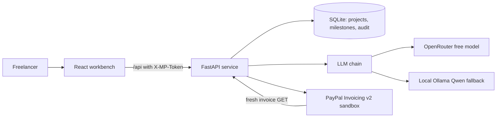

# MilestonePay

Approval-gated milestone billing for freelancers paid by overseas clients in **USD** through **PayPal (sandbox)**.

MilestonePay reads a contract with a free local model, proposes milestones, and requires a literal evidence quote for every amount and date. Fixed code checks the plan. A human approves it. Drafting and sending are separate clicks. The next milestone stays locked until PayPal confirms the previous one is **PAID**.

No escrow. No fund holding. No production keys. No real money in the demo.

## Why it is different

1. **Evidence-first extraction.** Every milestone carries the exact sentence it came from. Fixed code checks that the amount and due date appear inside that same quote. A model cannot approve anything.
2. **Payment-gated milestones.** A later milestone cannot be drafted or sent until an earlier one is confirmed PAID by a fresh PayPal lookup. A refund or cancellation after payment puts later milestones on hold.
3. **Reconciliation-first invoice creation.** An unknown create timeout locks the milestone. The app searches the exact unique invoice number before any retry, so a retry cannot create a duplicate invoice.

## Workbench features

- **Portfolio brief:** outstanding and collected totals, overdue count, and ranked next actions across every project.
- **Contract risk review:** evidence-quoted payment and scope risks with a suggested client question. Advisory only, not legal advice, and it never blocks approval by itself.
- **Editable plan:** fix a client name, amount, date, or total before approval. The evidence quote stays fixed, saving re-runs every check, and saving never approves the plan.
- **Payment side panel:** invoice, payer link, sandbox status, and the next valid action in one place.
- **Audit trail:** every proposal, edit, approval, draft, send, poll, and reconciliation is recorded.

## Modes (always labelled in the UI)

| Mode | PayPal | AI | Network |
|---|---|---|---|
| `MP_MODE=sample` (default) | Simulated stand-in | Fixture output for the bundled sample contract | None |
| `MP_MODE=live` | Real PayPal **sandbox** API, fake funds | `LLM_PROVIDER=auto` (OpenRouter free model, Ollama fallback), `openrouter`, or `ollama` | PayPal sandbox and the chosen LLM host |

`MP_MODE=live` refuses a non-sandbox base URL. Production is not supported.

## AI providers

The extraction layer has one interface and four provider modes. Sample mode is always fixture-only and keyless.

| `LLM_PROVIDER` | Behavior | Network |
|---|---|---|
| `sample` | Fixture output for the bundled contract | None |
| `ollama` | Local `qwen2.5:3b-instruct` through Ollama | Local only |
| `openrouter` | OpenRouter free model, with local Ollama as fallback | OpenRouter, then local |
| `auto` | OpenRouter if the external key file exists, otherwise Ollama | OpenRouter or local |

The OpenRouter key and preset live outside the repo in `~/milestonepay_secrets/.env.openrouter` on Windows, or `~/milestonepay_secrets/.env.openrouter` on macOS/Linux. The file can set `OPENROUTER_API_KEY`, `OPENROUTER_PRESET`, and `OPENROUTER_FALLBACKS`. The app reads it at runtime, never logs it, never returns it from the API, and never commits it. Provider tests use mocked HTTP, so the suite needs no key. If the OpenRouter call fails, `openrouter` and `auto` fall through to Ollama.

## Quick start on Windows (sample mode, no keys)

```powershell
git clone https://github.com/suhailult777/milestonepay
cd milestonepay
py -3 -m venv .venv
.\.venv\Scripts\pip install -r backend\requirements.txt
cd web
npm install
cd ..

# Create a local .env (git-ignored). Use any random local token.
@"
MP_MODE=sample
LLM_PROVIDER=sample
MP_ADMIN_TOKEN=<set-a-random-local-value>
MP_DB=milestonepay.sqlite3
MP_API_PORT=8000
MP_WEB_PORT=5173
"@ | Set-Content .env

# The app reads environment variables only. It does not auto-load .env.
# Run this block in each new terminal before the API or web app starts:
Get-Content .\.env | ForEach-Object {
  $line = $_.Trim()
  if ($line -eq '' -or $line.StartsWith('#')) { return }
  if ($line -notmatch '=') { return }
  $k, $v = $line -split '=', 2
  Set-Item -Path "Env:$($k.Trim())" -Value ($v.Trim().Trim("'`""))
}
cd backend
..\.venv\Scripts\uvicorn app.main:app --host 127.0.0.1 --port 8000

# Terminal B: same .env load, then
cd web
npm run dev
```

Open `http://127.0.0.1:5173`. In sample mode you can Extract, Approve, Draft, Send, Simulate client payment, Send a forged webhook, and **Arm create timeout** to see the reconciliation lock and exact-invoice-number recovery. The sample extractor only accepts the bundled contract text; switch `LLM_PROVIDER=ollama` for other contracts.

To reopen an existing project after a page reload, add its id: `http://127.0.0.1:5173/?project=<project_id>`. The project id is the middle part of an invoice number such as `MP-<project_id>-1`.

## Quick start on macOS or Linux (sample mode, no keys)

```bash
git clone https://github.com/suhailult777/milestonepay
cd milestonepay
python3 -m venv .venv
source .venv/bin/activate
pip install -r backend/requirements.txt
cd web && npm ci && cd ..

cp .env.example .env
# Edit .env: set a random MP_ADMIN_TOKEN.
# Leave MP_MODE=sample and LLM_PROVIDER=sample for the no-key demo.

# Terminal A: load .env and start the API
set -a; source .env; set +a
cd backend
uvicorn app.main:app --host 127.0.0.1 --port 8000

# Terminal B: load the same .env and start the web app
set -a; source .env; set +a
cd web
npm run dev
```

Open `http://127.0.0.1:5173`. The same sample-mode actions are available. For live PayPal sandbox mode, set the four `PAYPAL_*` values and `LLM_PROVIDER=auto` as described below.

Run the tests:

```powershell
cd backend
..\.venv\Scripts\python -m pytest -q
# 128 passed
```

## Live PayPal sandbox

1. Sign in at https://developer.paypal.com with **your own** account.
2. Create a **Sandbox** app under Apps & Credentials. Copy its client id and secret into a local git-ignored `.env`. Never commit them.
3. Create or use a sandbox **business** account. Put its email in `PAYPAL_MERCHANT_EMAIL`.
4. Create a sandbox **personal** account in a supported country (US recommended). PayPal blocks USD invoices to India-addressed buyers with `INR_FOREIGN_CURRENCY_BLOCKED`.
5. Set `MP_MODE=live`, `LLM_PROVIDER=auto` (or `openrouter` or `ollama`), and all four `PAYPAL_*` names. `PAYPAL_WEBHOOK_ID` is required by the config even for poll-only runs.
6. Start the API and web app as above. Extract a fictional contract, approve, draft milestone 1, send it (no PayPal email is sent), open the payer link, and pay with **sandbox funds**. Then click **Check PayPal status**.

`send_to_invoicer=false` and `send_to_recipient=false` are fixed in code, so PayPal emails no one. The payer link is shown in the UI.

### Optional signed webhook

Polling is the verified path. A signed webhook is optional and needs a public HTTPS endpoint. Expose only the webhook-only proxy (`backend/webhook_proxy.py`), never the UI or the full API. Register `https://<tunnel>/api/webhooks/paypal` for `INVOICING.INVOICE.PAID`, `REFUNDED`, and `CANCELLED`, then set `PAYPAL_WEBHOOK_ID`. Unsigned or invalid events fail closed.

## How a payment is accepted

A milestone becomes `PAID` only after a **fresh `GET`** of the PayPal invoice confirms all of:

- status `PAID`
- merchant email matches `PAYPAL_MERCHANT_EMAIL`
- invoice and paid currency are `USD`
- invoice amount and paid amount equal the milestone amount exactly

Partial, refunded, cancelled, `MARKED_AS_PAID`, wrong merchant, wrong currency, and wrong amount never unlock the next milestone. Mismatches become `MISMATCH` and are shown with the audit trail.

## Architecture



Modules:

- `web/`: React 19 + TypeScript + Vite workbench.
- `backend/app/main.py`: FastAPI routes and the local token guard.
- `backend/app/service.py`: plan validation, gates, draft/send, reconciliation, holds, risk storage, portfolio brief.
- `backend/app/extraction.py`: shared extraction interface and deterministic plan checks.
- `backend/app/risk.py`: evidence-backed contract risk review.
- `backend/app/llm.py`: OpenRouter primary + Ollama fallback; key read at runtime.
- `backend/app/paypal.py`: `SandboxPayPal` (Invoicing v2) + `SimulatedPayPal` (sample only).
- `backend/app/db.py`: SQLite schema, additive migrations, audit log, transactions.

Flow: `extract -> validate -> optional risk review -> human edit/approve -> draft -> human send -> PayPal fresh GET -> PAID -> next milestone unlocks`.

`GET /api/info` is public. The project list, project detail, risk review, plan edit, portfolio brief, approve, draft, send, reconcile, refresh, and simulate routes require `X-MP-Token`. This is a **single-operator local tool**, not multi-tenant. Real authentication and CSRF are required before any public exposure of the UI or API.

## Verified and not verified

Verified on this laptop on 10 Nov 2026:

- 128 mocked/simulated tests pass (`pytest -q`), including amount and date boundary tables, range/limit evidence, prompt-injection cases, API routes, config validation, risk quote checks, plan editing, and the portfolio brief.
- OpenRouter and Ollama providers are covered by mocked HTTP tests; the external key file builds the OpenRouter -> Ollama chain.
- A live OpenRouter free-model smoke test was attempted on 10 Nov 2026 with the bundled sample contract. The three allowed explicit `:free` calls did not pass: two earlier attempts failed before the final guarded call, and the final call on `google/gemma-4-26b-a4b-it:free` was rate-limited. No live free-model run is claimed. The redacted artifact is `backend/evals/openrouter_smoke_20261110.json`. `LLM_PROVIDER=auto` falls back to local Ollama.
- Sample-mode UI flow clicked end to end in a browser with the earlier layout: extract, approve, draft, send, simulated payment, milestone 1 `PAID`, milestone 2 unlocked, milestone 3 still locked.
- UI v2 evidence workbench loaded against a seeded sample project with milestone 1 `PAID`, milestone 2 `DRAFTED`, milestone 3 `LOCKED`; the send confirmation dialog and dark-mode toggle were checked in the browser.
- Phase 2 workbench checked in the browser: portfolio brief with two projects, USD 2600.00 outstanding and USD 400.00 collected; both evidence-backed risk notes rendered with their client questions; the edit form saved a client-name change, kept validation clean, and wrote an `edited_plan` audit entry. The approval, draft, send, and payment gates were unchanged.
- **Live PayPal sandbox UI flow** clicked end to end with local Qwen extraction: approve, draft, send, buyer payment, fresh `GET`, `PAID`. Real sandbox invoice `INV2-49NL-8AUM-4U23-WUYL` for USD 400.00 was paid with fake sandbox funds. The app checks returned merchant, currency, amount, and paid_full all true.
- Milestone 2 was then drafted only (`INV2-8VKB-NZRP-SFZX-ZPNS`, status `DRAFTED`), not sent and not paid. Milestone 3 stayed `LOCKED`.
- Web production build passes.

Historical real PayPal sandbox evidence from the development box (8 Nov 2026, not re-run on this laptop):

- Two sandbox invoices created and sent with no emails, paid with fake $1 from a US sandbox buyer, and confirmed `PAID` by a fresh `GET` (status, merchant, currency, exact amount).
- An unsigned forged webhook was rejected with HTTP 400.

Not verified anywhere:

- A valid **signed** PayPal webhook (no public endpoint was reachable; polling is the verified path).
- A live sandbox refund or chargeback (mocked only).
- A live OpenRouter free-model response. Three allowed calls on 10 Nov 2026 did not pass; the final call was rate-limited.
- Real money movement, production behavior, multi-user auth, or fraud detection.

### PayPal Sandbox evidence

The sandbox invoice and payment IDs in `backend/evals/sandbox_smoke_artifact.json` and `backend/evals/laptop_sandbox_payment_20261110.json` are **PayPal Sandbox evidence, no real funds**. They are not credentials, payer links, or live transactions. Payer links and personal data are redacted.

## Security notes

- Secrets only from environment; `.env` is git-ignored; tokens and secrets are not logged.
- The OpenRouter key is read at runtime from a file outside the repo. It is never logged, returned from the API, or committed. `LLM_PROVIDER=auto` falls back to local Ollama when the key file is absent.
- Webhooks use PayPal's official signature verification with raw body bytes; missing headers or verify errors fail closed. Event ids are de-duplicated.
- Money state comes from PayPal's invoice record, never from the webhook body.
- Invoice creation uses a stored `PayPal-Request-Id` and an atomic `NONE -> IN_FLIGHT` claim. Definite 4xx releases the claim. Timeout, 5xx, or crash requires human reconciliation by the exact invoice number.
- Dev servers bind to `127.0.0.1`. Do not expose the API publicly.

## Licence

MIT, Copyright (c) 2026 Mohd Idrisi. See `LICENSE`.
